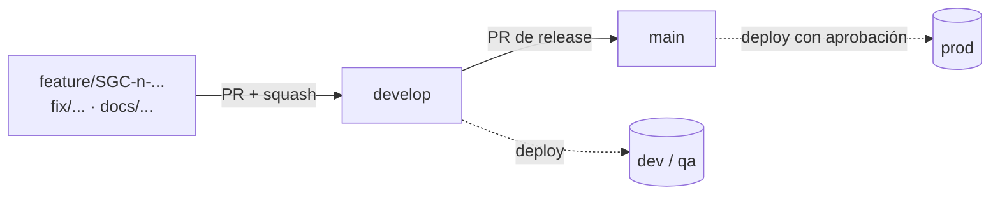

# SIGEC · Sistema de Gestión de Cumplimiento

Proyecto Integrador del Diploma **DevOps Engineer** (DMC Institute).

SIGEC evalúa el nivel de cumplimiento de **ciberseguridad** de una organización con un checklist de 5 dimensiones, 20 indicadores y 112 ítems de control. Calcula el porcentaje de cumplimiento por dimensión, guarda el histórico de evaluaciones, exporta reportes en PDF y Excel, y registra una auditoría de cambios. Tiene tres roles: administrador, evaluador y consulta.

## Equipo

| Integrante | Rol técnico | Rol Scrum |
|---|---|---|
| William Huamán | DevOps / Cloud Engineer | Scrum Master |
| Jesús | Developer (backend y base de datos) | Product Owner |

## Stack

- **Backend:** Laravel 13 (PHP 8.4), Sanctum, Spatie Permission, DomPDF y Laravel Excel
- **Frontend:** React 19, Vite y MUI
- **Base de datos:** MySQL 8
- **Local:** Docker Compose (nginx, php-fpm, Vite, MySQL y Adminer)
- **Nube (en construcción):** Azure con Terraform, GitHub Actions y Grafana

## Levantar en local

Requisitos: Docker Desktop. Se ejecuta desde la raíz del repositorio.

```bash
cp backend/.env.example backend/.env          # ajustar DB_* para MySQL (ver docker-compose.yml)
docker compose build
docker compose run --rm backend composer install
docker compose run --rm backend php artisan key:generate
docker compose run --rm frontend npm install
docker compose up -d
docker compose exec backend php artisan migrate --seed
```

- App: http://localhost:8080. Los usuarios de prueba los crea `RoleUserSeeder`.
- Adminer: http://localhost:8081

> ⚠️ **No ejecutes `php artisan test` dentro del contenedor tal cual.** El compose carga `backend/.env`, que pisa la configuración de pruebas, y las pruebas borran la base de desarrollo. Usa una base aparte (tarea pendiente en Jira):
> `docker compose exec -e APP_ENV=testing -e DB_DATABASE=sigec_test backend php artisan test`

## Gestión del proyecto

- Backlog y sprints: Jira (proyecto **SGC**)
- Plan y backlog detallado: [`docs/backlog.md`](docs/backlog.md)

## Flujo de trabajo y ramas

Usamos dos ramas permanentes, ambas protegidas: no aceptan push directo, force push ni borrado, y todo entra por Pull Request.

| Rama | Para qué | Despliega en (cuando exista el CD) |
|---|---|---|
| `develop` | Integración del trabajo diario. Es la rama por defecto. | dev y qa |
| `main` | Versión estable. Solo recibe PRs desde `develop`. | prod, con aprobación manual |



**Ciclo de cada tarjeta de Jira:**

1. `git switch develop && git pull`
2. `git switch -c tipo/SGC-n-descripcion`. Tipos: `feature`, `fix`, `docs`, `ci`, `chore` o `infra`.
3. Commits en formato Conventional Commits con la clave al final, por ejemplo `feat: filtra evaluaciones por dimensión SGC-19`.
4. PR hacia `develop` con título `SGC-n tipo: descripción`, usando la plantilla.
5. Revisión del otro integrante (recomendada) y **squash merge**. La rama se borra sola.
6. Para liberar una versión: PR de `develop` a `main`.

## Avance

- [x] Sesión 1 (13 oct): grupo, proyecto y problemática
- [ ] Sesión 2 (19 nov): elección de software, gestión de backlog e IaC
- [ ] Sesión 3 (15 dic): CI/CD, monitoreo e informe
- [ ] Sesión 4 (4 feb): sustentación final
